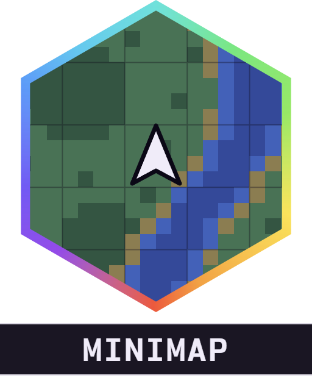
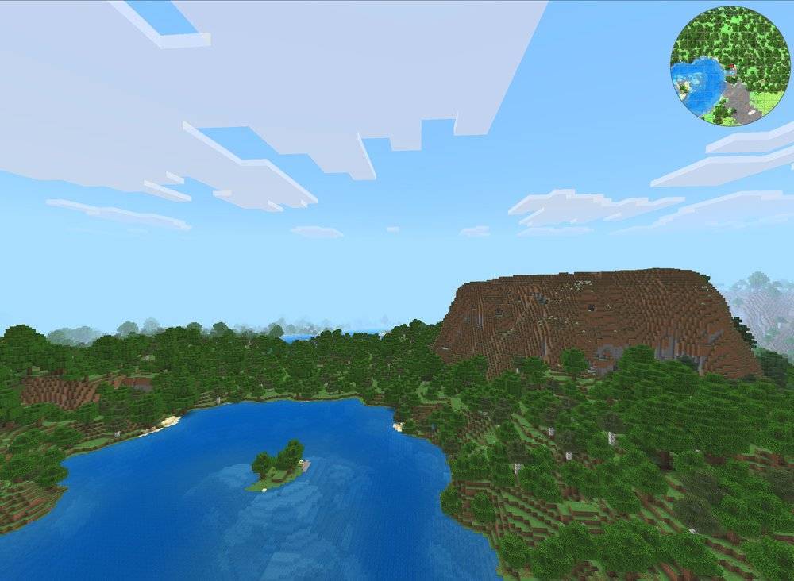
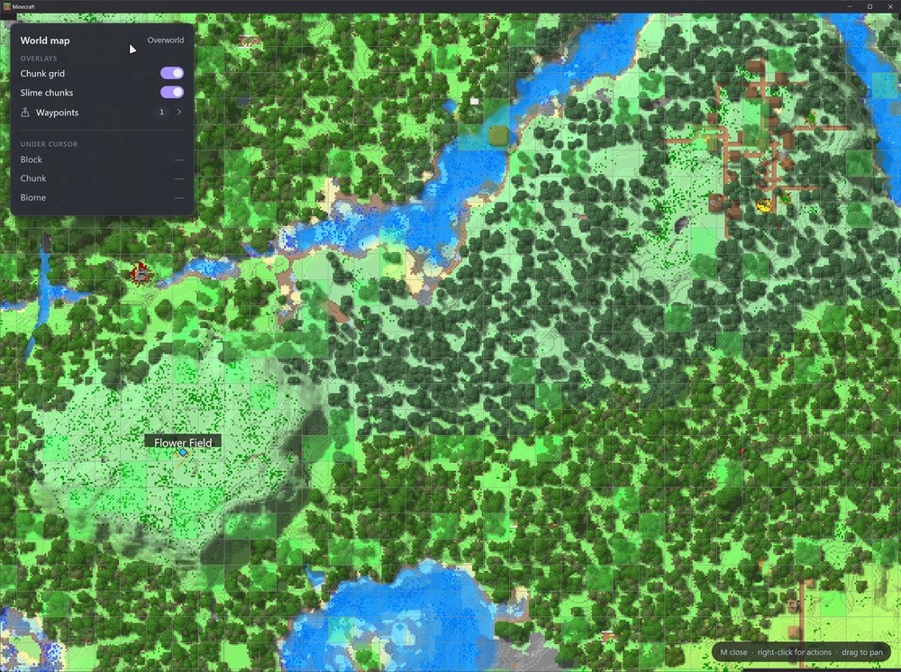
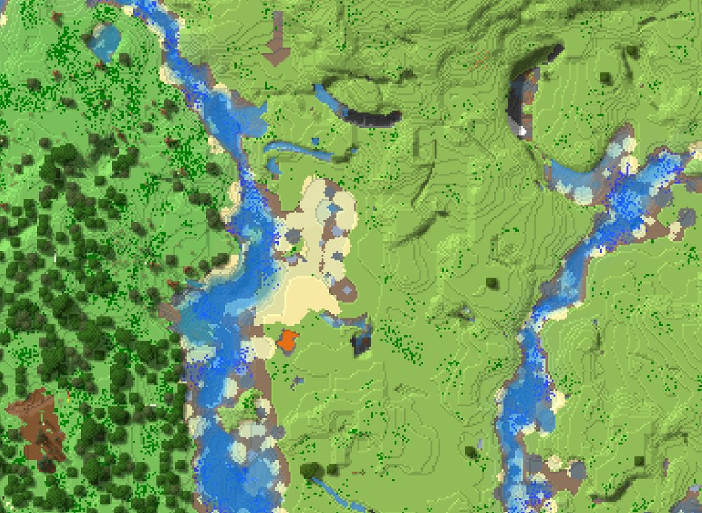
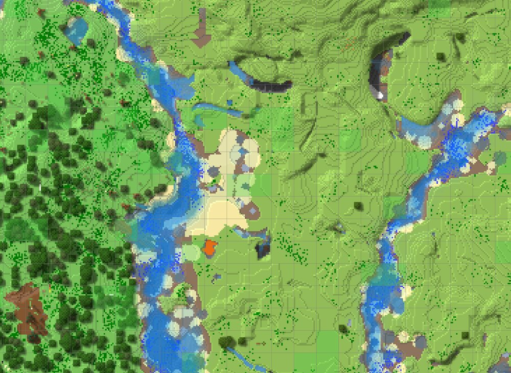
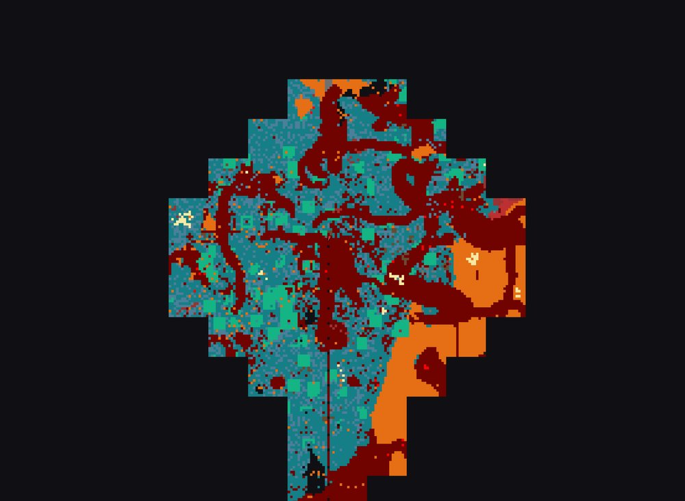
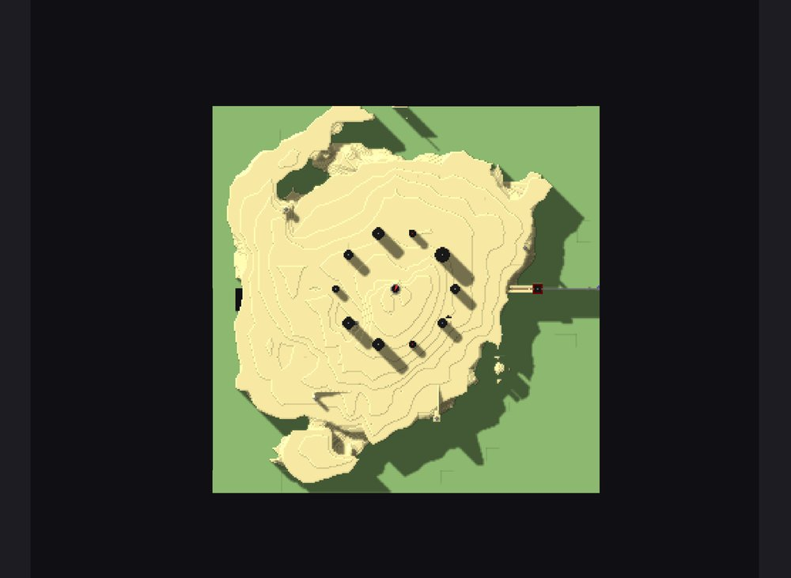

<div align="center">



# Alaydriem's Mini Map

[](https://github.com/alaydriem/levi-minimap/releases)
[](https://github.com/alaydriem/levi-minimap/actions/workflows/build.yml)
[](./LICENSE)

[](https://github.com/LiteLDev/LeviLamina)

</div>

A minimap and full-screen world map for Minecraft Bedrock, with waypoints, cave mode and PNG export.

Client-side only. The map is built from the chunks your game has already loaded.

## Features

- Round minimap with chunk grid, coordinates and Nether / Overworld coordinates
- Full-screen world map of everything you've explored, in every dimension
- Block, chunk and biome info under the cursor
- Chunk grid and slime chunk overlays
- Waypoints per world, with search, distances, colours and a death point
- Cave mode for mapping underground
- Terrain shading, depth-shaded water and custom block / biome colours
- Export the view or the whole explored area to PNG
- Explored areas are cached on disk

<table>
  <tr>
    <td width="50%"></td>
    <td width="50%"></td>
  </tr>
  <tr>
    <td width="50%"></td>
    <td width="50%"></td>
  </tr>
  <tr>
    <td width="50%"></td>
    <td width="50%"></td>
  </tr>
</table>

## Installation

Requires the client build of [LeviLamina](https://github.com/LiteLDev/LeviLamina) and [Alaydriem's Mod Manager](https://github.com/alaydriem/levi-modmanager).

```powershell
lip install github.com/alaydriem/levi-minimap#client
```

Or download the zip from the [latest release](https://github.com/alaydriem/levi-minimap/releases/latest) and extract it into `mods/`.

| Mini Map | Minecraft Bedrock | LeviLamina | Mod Manager |
| --- | --- | --- | --- |
| 0.1.0 | 1.26.51 | 26.51.6+ | 0.1.x |

## Controls

| Key | Action |
| --- | --- |
| <kbd>M</kbd> | Open / close the world map |
| <kbd>Ctrl</kbd> + <kbd>M</kbd> | Show / hide the minimap |
| <kbd>=</kbd> / <kbd>-</kbd> | Zoom the minimap |
| <kbd>N</kbd> | Add a waypoint at your position |
| <kbd>K</kbd> | Cave mode on / off |
| <kbd>Ctrl</kbd> + <kbd>K</kbd> | Show / hide coordinates |
| <kbd>Esc</kbd> | Close the world map, menu or dialog |
| Mouse wheel | Zoom the world map |
| Left-drag | Pan the world map |
| Right-click | Map menu (waypoints, copy coordinates, export) |
| <kbd>Ctrl</kbd> + <kbd>Z</kbd> | Undo a waypoint removal |

The first seven keys can be changed on the mod manager's Keybinds page.

## Configuration

Settings are in the mod manager panel and saved to `mods/alaydriem-minimap/config/config.hcl`.

| Setting | Default | Description |
| --- | --- | --- |
| `mini_map.radius_chunks` | `5` | Minimap radius in chunks |
| `mini_map.size_ratio` | `0.15` | Minimap size as a fraction of screen width |
| `mini_map.rotate_with_player` | `false` | Rotate the minimap with the player |
| `mini_map.show_nether_coordinates` | `true` | Show Nether / Overworld coordinates |
| `world_map.rotate_with_player` | `false` | Rotate the world map with the player |
| `world_map.show_chunk_grid` / `show_slime_chunks` | `false` | Chunk grid and slime chunks |
| `waypoints.max_per_world` | `512` | Max waypoints per world |
| `terrain.shadow.render_style` | Shadow map | Flat, Gradient or Shadow map |
| `terrain.enable_transparent_water` | `true` | Show the ground under shallow water |
| `memory.gpu_texture_budget_mb` | `496` | GPU memory for map tiles |

Custom colours and the export folder are set in `config.hcl` only:

```hcl
terrain {
  block_colors          = { "minecraft:lava" = [230, 110, 20, 255] }
  biome_color_overrides = { "the_end" = [16, 12, 26, 255] }
}

export {
  # empty means Pictures/Screenshots
  folder = ""
}
```

Waypoints and the map cache are in `mods/alaydriem-minimap/data/`.

## FAQ

**Part of the map is empty.** The map only shows chunks your game has loaded. Visit the area once and it stays.

**Can I use it on servers?** Yes, but some servers don't allow minimaps. Check the rules first.

**The biome shows a dash.** Areas explored with an older version have no biome saved. Revisit them to fill it in.

## Building

Requires Windows x64, [mise](https://mise.jdx.dev), rustup, [cargo-nextest](https://nexte.st) and LLVM (`clang-cl`).

```powershell
mise trust
mise run preflight
mise run build-mod
mise run test
```

## License

BSD 3-Clause. Copyright (c) 2026 Charles R. Portwood II. See [LICENSE](./LICENSE). [Nordwand Mono](https://github.com/tywr/Nordwand-Mono) is under the SIL Open Font License 1.1.

Inspired by [CoralMap](https://github.com/CoralFans-Dev/CoralMap).
